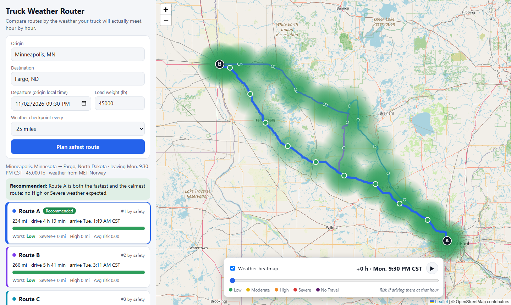
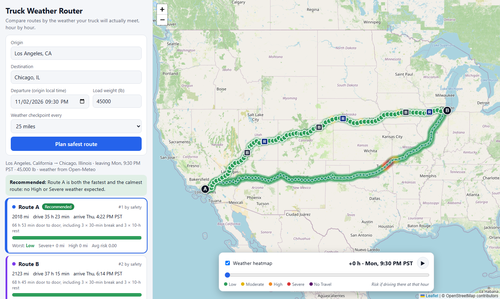

# Truck Weather Router

A React + Django app that helps a truck driver pick the safest route. Enter an origin, destination, departure time and load weight. The app returns three route options, checks the forecast along each one **at the time the truck will actually be there**, scores the risk with the brief's rules, and recommends a route with a one-line reason. A heatmap with a 0 to 48 hour slider shows how conditions along the corridor evolve.

**Live demo: https://truck-weather-router.onrender.com** (free hosting: the server sleeps when idle, so the first load can take up to a minute)





## How it works

1. **Geocoding**: Nominatim (OpenStreetMap) turns place names into coordinates. The origin's time zone is resolved offline, so the departure time the user types is local time at the origin and every time in the UI is shown on that clock (for example CST).
2. **Routing**: the public OSRM server returns driving alternatives. If it returns fewer than three distinct roads, the backend asks for more by routing through via-points offset sideways from the midpoint (all requested in parallel), then drops anything that is the same road (average distance under 2 miles) or more than 60% slower than the fastest route.
3. **Truck timing**: OSRM returns a travel time for every road segment. Each segment is slowed to at most 65 mph (the usual US truck limit), so ETAs follow the real road: slow through cities, fast on interstates. On top of that the driver's US Hours-of-Service rules are applied: a 30-minute break after 8 hours of driving and a 10-hour rest after 11 hours. Those stops push every later ETA back and are shown on the map (B and R markers) and in the route details.
4. **Checkpoints**: points are placed every 10, 25 or 50 miles (user's choice) along each route, plus start and end. Each gets its ETA from step 3.
5. **Weather**: hourly forecasts (wind in mph, rain and snowfall in inches per hour) for every checkpoint, fetched in parallel batches from Open-Meteo and cached for 30 minutes. If Open-Meteo is overloaded or down, the missing locations are fetched from MET Norway instead, so the app keeps working; the UI says which source was used. Values are interpolated between forecast hours to the exact ETA.
6. **Risk**: the brief's thresholds are applied to wind, rain and snow separately (the worst wins), then the load rules:
   - wind >= 55 mph: No Travel for any load
   - wind 45 to 54 mph with a load over 30,000 lb: No Travel
   - wind 35 to 44 mph with a load over 40,000 lb: Severe
7. **Recommendation**: routes are ranked by, in order: no No Travel checkpoint, fewest Severe miles, fewest High miles, lowest distance-weighted average risk, shortest door-to-door time. The UI explains the trade-off in one sentence (for example "Route C costs 2 h 55 min more than Route A but avoids 40 miles of Severe weather").
8. **Heatmap**: for each checkpoint the backend also scores the weather at departure + 0, 1, ... 48 hours. The slider moves in 15-minute steps and the canvas layer blends colours between hours, so dragging or pressing play is smooth and needs no further requests. Colour means risk level (green, yellow, orange, red, purple), not point density.

## Code layout

```
backend/                      Django, no database (every plan is computed live)
  routing/views.py            HTTP layer: input validation, error -> status code mapping
  routing/services/
    planner.py                orchestration: checkpoints, ETAs, risk summary, ranking, recommendation
    risk.py                   the brief's thresholds and load rules (pure functions)
    hos.py                    Hours-of-Service: driving time -> clock time, list of stops
    osrm.py                   routing API, truck speed cap, alternative-route search
    weather.py                Open-Meteo + MET Norway fallback, hourly interpolation, cache
    geocode.py                Nominatim search, offline time-zone lookup
    geo.py                    haversine, interpolation along a polyline
  routing/tests.py            33 tests (no network: external services are faked)
frontend/src/
  App.jsx                     state: plan, selected route, slider hour
  components/                 PlanForm, RouteCards, CheckpointTable, MapView, HeatControl
  HeatLayer.js                custom Leaflet canvas layer for the risk heatmap
```

## Run locally

Backend (Python 3.11+):

```bash
cd backend
pip install -r requirements.txt
DJANGO_DEBUG=1 python manage.py runserver 127.0.0.1:8000
```

Frontend (Node 20+), in another terminal:

```bash
cd frontend
npm install
npm run dev
```

Open http://127.0.0.1:5173. The Vite dev server proxies `/api` to Django. No API keys are needed.

Checks (the same ones CI runs on every push):

```bash
cd backend && python manage.py test && ruff check .
cd frontend && npm run lint && npm run build
```

The tests cover every risk threshold and load rule, ranking and recommendation text, truck speed, Hours of Service, forecast interpolation, the MET Norway fallback, time-zone handling, the API's validation, and a full `plan_trip` run with all external services replaced by fakes (a gale on one road must send a heavy truck the other way).

## API

| Endpoint | Description |
|---|---|
| `POST /api/plan` | body: `origin`, `destination`, `departure` (ISO time; without an offset it is local time at the origin), `weight_lb`, `interval_mi` (10, 25 or 50). Returns three routes with geometry, checkpoints (ETA, weather, risk, reasons, 49-hour heat series), driver stops, risk summaries and the recommendation. |
| `GET /api/places?q=` | place-name suggestions for the form |
| `GET /api/health` | liveness check |

Errors return `{"error": "..."}` with status 400 (bad input) or 502 (an upstream service failed).

## Deploy

**Vercel (alternative).** `vercel.json` builds the React app and serves it from Vercel's CDN. `api/index.py` runs the Django app as a serverless function, and `/api/*` is routed to it.

**Render (live demo).** `render.yaml` is a Render blueprint. It builds the React app, installs the Django app and serves both from one gunicorn service (WhiteNoise serves `frontend/dist`).

## Assumptions and limits

- **Routing uses a car road network.** The free public OSRM server has no truck profile, so low bridges, weight-restricted roads and hazmat rules are not considered, and live traffic is not included. Truck speed (65 mph cap) and driver breaks are modelled on top. A production version would swap in a commercial truck router; only `osrm.py` would change.
- **Hours of Service is simplified** to the 11-hour driving limit, 10-hour rest and 30-minute break, starting from a fresh driver. The 14-hour on-duty window and weekly limits are not modelled. While the truck is parked for a rest, the weather at the parking spot is not scored (the truck is not driving).
- **Forecast horizon.** Forecasts reach about 10 days, so departures are limited to the next 5 days (so the 48 h slider and long trips stay inside the forecast).
- **Wind is sustained 10 m wind, not gusts.** The brief's table speaks of wind speed, so gusts are not used.
- **Snow is snowfall in inches per hour** (not liquid equivalent), matching the brief's units. MET Norway has no snowfall field, so when it is the source, precipitation at or below 0 °C counts as snow at the common 10:1 ratio.
- **Boundaries.** Where the brief's ranges touch (for example rain exactly 0.25), the higher level applies. No Travel for rain and snow is strictly greater than 1.00 and 3.0.
- **A stretch takes the worse of its two end checkpoints** when miles per risk level are counted, which is conservative.
- **Public free services.** OSRM, Nominatim, Open-Meteo and MET Norway are shared free services with usage limits. A plan usually takes 5 to 10 seconds, mostly waiting on them; every call that can run in parallel does.
- US locations only (geocoding is restricted to the US).
